<div align="center">


# Compose Bottombar

**A collection of beautiful, animated, customizable bottom bars for Jetpack Compose.**

Drop one in, pass your items, and get a polished bar that looks right in light and dark themes, with a colors API for when you want your own palette.


[](https://central.sonatype.com/artifact/io.github.nameisjayant/compose-bottombar)


</div>

---

## Preview

<table>
  <tr>
    <th colspan="2">Halo BottomBar</th>
  </tr>
  <tr>
    <td align="center" width="50%">☀️ Light</td>
    <td align="center" width="50%">🌙 Dark</td>
  </tr>
  <tr>
    <td valign="top">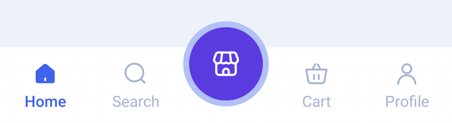</td>
    <td valign="top">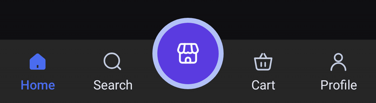</td>
  </tr>
</table>

<table>
  <tr>
    <th colspan="2">Dome BottomBar</th>
  </tr>
  <tr>
    <td align="center" width="50%">☀️ Light</td>
    <td align="center" width="50%">🌙 Dark</td>
  </tr>
  <tr>
    <td valign="top">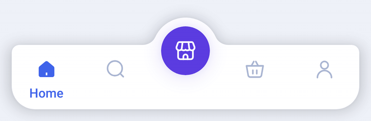</td>
    <td valign="top">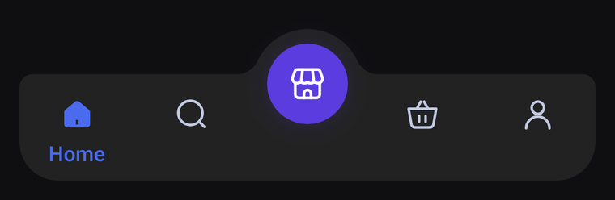</td>
  </tr>
</table>

<table>
  <tr>
    <th colspan="2">Cradle BottomBar</th>
  </tr>
  <tr>
    <td align="center" width="50%">☀️ Light</td>
    <td align="center" width="50%">🌙 Dark</td>
  </tr>
  <tr>
    <td valign="top">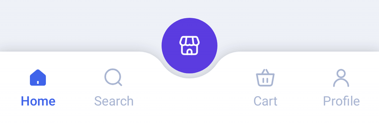</td>
    <td valign="top">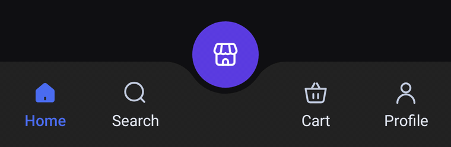</td>
  </tr>
</table>

<table>
  <tr>
    <th colspan="2">Valley BottomBar</th>
  </tr>
  <tr>
    <td align="center" width="50%">☀️ Light</td>
    <td align="center" width="50%">🌙 Dark</td>
  </tr>
  <tr>
    <td valign="top">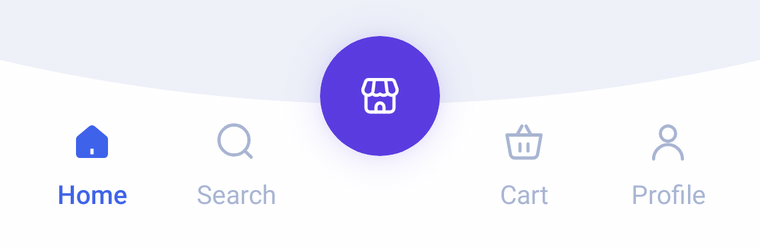</td>
    <td valign="top">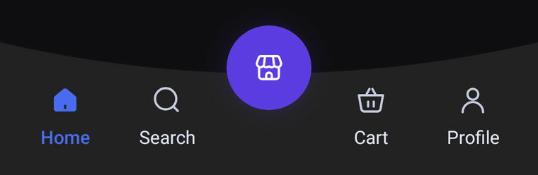</td>
  </tr>
</table>

<table>
  <tr>
    <th colspan="2">Socket BottomBar</th>
  </tr>
  <tr>
    <td align="center" width="50%">☀️ Light</td>
    <td align="center" width="50%">🌙 Dark</td>
  </tr>
  <tr>
    <td valign="top"></td>
    <td valign="top">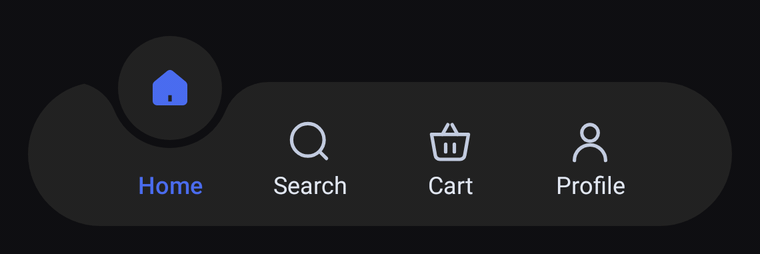</td>
  </tr>
</table>

<table>
  <tr>
    <th colspan="2">Gable BottomBar</th>
  </tr>
  <tr>
    <td align="center" width="50%">☀️ Light</td>
    <td align="center" width="50%">🌙 Dark</td>
  </tr>
  <tr>
    <td valign="top">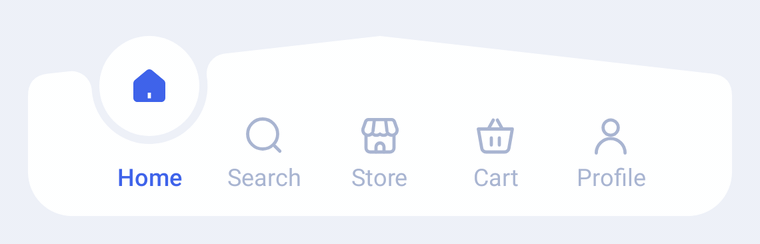</td>
    <td valign="top">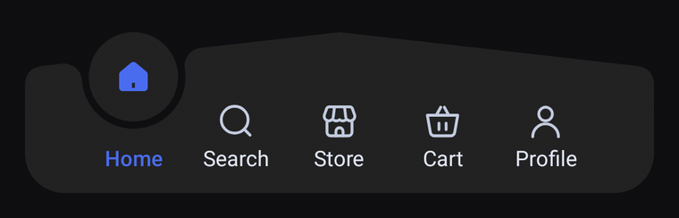</td>
  </tr>
</table>

<table>
  <tr>
    <th colspan="2">Diamond BottomBar</th>
  </tr>
  <tr>
    <td align="center" width="50%">☀️ Light</td>
    <td align="center" width="50%">🌙 Dark</td>
  </tr>
  <tr>
    <td valign="top"></td>
    <td valign="top">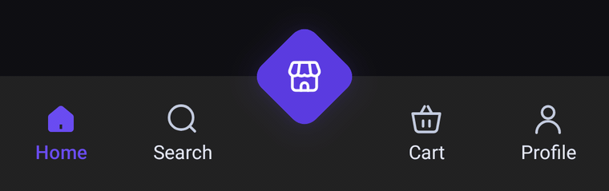</td>
  </tr>
</table>

<table>
  <tr>
    <th colspan="2">Wave BottomBar</th>
  </tr>
  <tr>
    <td align="center" width="50%">☀️ Light</td>
    <td align="center" width="50%">🌙 Dark</td>
  </tr>
  <tr>
    <td valign="top"></td>
    <td valign="top">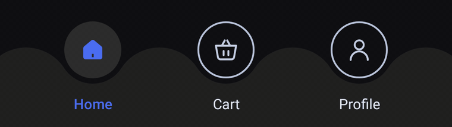</td>
  </tr>
</table>

<table>
  <tr>
    <th colspan="2">Rail BottomBar</th>
  </tr>
  <tr>
    <td align="center" width="50%">☀️ Light</td>
    <td align="center" width="50%">🌙 Dark</td>
  </tr>
  <tr>
    <td valign="top">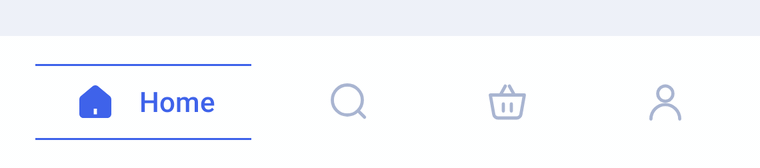</td>
    <td valign="top">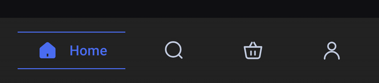</td>
  </tr>
</table>

<table>
  <tr>
    <th colspan="2">Crest BottomBar</th>
  </tr>
  <tr>
    <td align="center" width="50%">☀️ Light</td>
    <td align="center" width="50%">🌙 Dark</td>
  </tr>
  <tr>
    <td valign="top"></td>
    <td valign="top">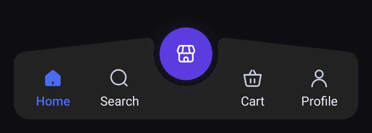</td>
  </tr>
</table>

<table>
  <tr>
    <th colspan="2">Scribble BottomBar</th>
  </tr>
  <tr>
    <td align="center" width="50%">☀️ Light</td>
    <td align="center" width="50%">🌙 Dark</td>
  </tr>
  <tr>
    <td valign="top">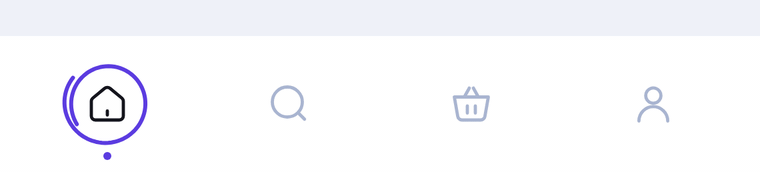</td>
    <td valign="top">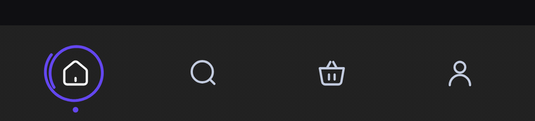</td>
  </tr>
</table>

<table>
  <tr>
    <th colspan="2">Bead BottomBar</th>
  </tr>
  <tr>
    <td align="center" width="50%">☀️ Light</td>
    <td align="center" width="50%">🌙 Dark</td>
  </tr>
  <tr>
    <td valign="top">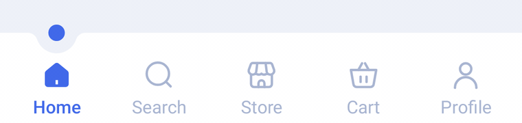</td>
    <td valign="top">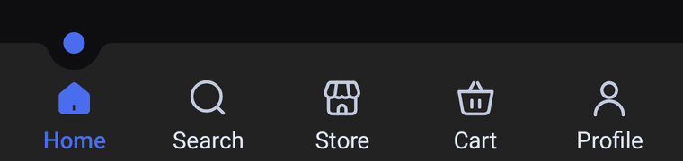</td>
  </tr>
</table>

<table>
  <tr>
    <th colspan="2">Peak BottomBar</th>
  </tr>
  <tr>
    <td align="center" width="50%">☀️ Light</td>
    <td align="center" width="50%">🌙 Dark</td>
  </tr>
  <tr>
    <td valign="top">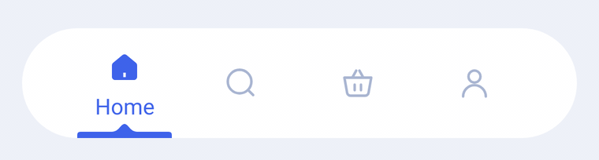</td>
    <td valign="top">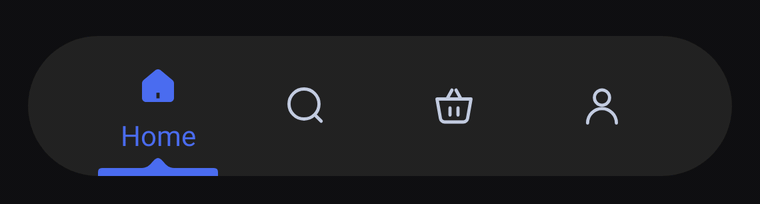</td>
  </tr>
</table>

<table>
  <tr>
    <th colspan="2">Teardrop BottomBar</th>
  </tr>
  <tr>
    <td align="center" width="50%">☀️ Light</td>
    <td align="center" width="50%">🌙 Dark</td>
  </tr>
  <tr>
    <td valign="top">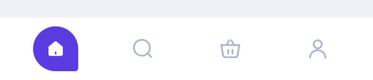</td>
    <td valign="top">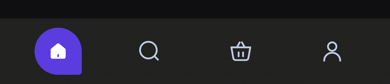</td>
  </tr>
</table>

<table>
  <tr>
    <th colspan="2">Orbit BottomBar</th>
  </tr>
  <tr>
    <td align="center" width="50%">☀️ Light</td>
    <td align="center" width="50%">🌙 Dark</td>
  </tr>
  <tr>
    <td valign="top">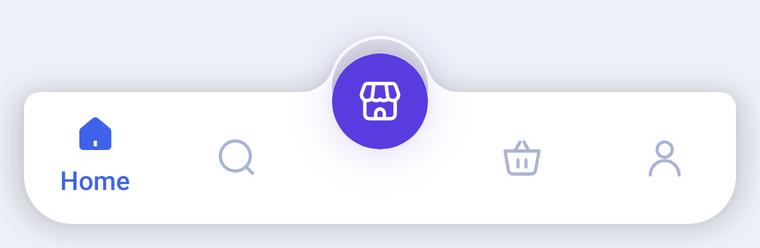</td>
    <td valign="top">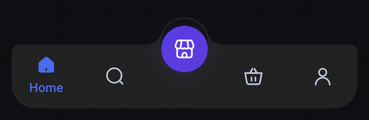</td>
  </tr>
</table>

<table>
  <tr>
    <th colspan="2">Tile BottomBar</th>
  </tr>
  <tr>
    <td align="center" width="50%">☀️ Light</td>
    <td align="center" width="50%">🌙 Dark</td>
  </tr>
  <tr>
    <td valign="top">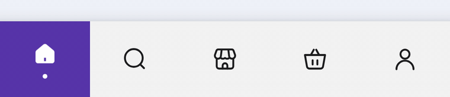</td>
    <td valign="top">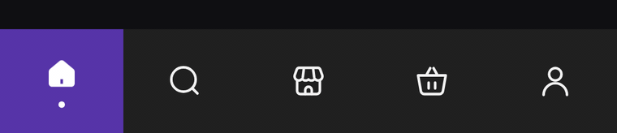</td>
  </tr>
</table>

## Features

- 🎯 **Ready to use**: pass a list of items and the selected index, and you get a finished bar.
- 🌗 **Light and dark built in**: every bar ships both palettes and follows the system theme by default.
- ✨ **Animated by default**: icon swaps, spring bounces, color fades and bar-specific touches like the Halo burst, the Dome's sliding labels, the Cradle's orb ripple, the Valley's orb press, the Socket's gliding bubble, the Gable's bubble sliding along its roof line, the Diamond's quarter-turn spin, the Wave's rings filling into solid orbs, the Rail's rails growing around the selected tab, the Crest's orb popping up as its wings dip, the Scribble's loop drawing itself around the selected icon, the Bead hopping from notch to notch, the Peak's strip stretching from tab to tab, the Teardrop popping out of its pointed tip, the ring rippling out of the Orbit's orb or the Tile stretching as it slides from tab to tab.
- 🎨 **Customizable**: change any color through `XxxBottomBarDefaults.lightColors(...)` / `darkColors(...)`, plus label style and window insets.
- ♿ **Accessible**: items are exposed as selectable tabs in a selectable group, so TalkBack reads them correctly.
- 🪶 **Light dependencies**: only Compose UI, Foundation and Animation. No Material, icons or navigation library is forced on your app.
- 🔒 **Explicit API mode**, so the public API is exactly what is meant to be public.

## Bottom bars

| Bar | Composable | Highlights |
|---|---|---|
| **Halo** | `HaloBottomBar` | A flat bar with a raised, ringed center orb. Outlined/filled icon swap, spring bounce on selection, and a ring that ripples out of the orb when it is selected |
| **Dome** | `DomeBottomBar` | A floating, rounded bar whose top edge swells into a dome around a glowing orb. Icon-only tabs; the selected one fills in and its label slides up underneath |
| **Cradle** | `CradleBottomBar` | A flat bar whose top edge dips into a smooth notch that cradles a raised orb. Icons and labels always show; the selected tab fills in and turns the accent color, and a ring ripples out of the orb when it is selected |
| **Valley** | `ValleyBottomBar` | A bar whose whole top edge sags in one smooth curve, with a glowing orb resting in the low point. Icons and labels always show; when the orb is selected it presses into the valley, which sinks with it and springs back |
| **Socket** | `SocketBottomBar` | A floating pill where the selected icon lifts out of the bar into a bubble, resting in a socket cut into the top edge. Works with any number of tabs; the bubble and its socket glide from tab to tab |
| **Gable** | `GableBottomBar` | A floating bar whose top edge rises like a roof to a peak in the middle. The selected icon lifts into a bubble resting in a socket cut into the slope, and both glide along the roof line from tab to tab |
| **Diamond** | `DiamondBottomBar` | A flat bar with a glowing diamond centered on its top edge. Icons and labels always show; the selected tab fills in and turns the accent color, and the diamond spins a quarter turn into place when it is selected |
| **Wave** | `WaveBottomBar` | A flat bar whose top edge rolls in a wave, with every tab floating in its own dip. Unselected tabs show their icon in a thin ring; the selected ring springs into a solid orb with a filled icon, and its label turns the accent color |
| **Rail** | `RailBottomBar` | A flat bar of icon-only tabs. The selected tab widens to show its label beside a filled icon, and two thin accent rails grow out from its center, one above and one below |
| **Crest** | `CrestBottomBar` | A floating bar split into two wings whose top edges climb towards the center, where a glowing orb rests in a round socket between them. Icons and labels always show; when the orb is selected it pops up out of the socket while the wings dip under it |
| **Scribble** | `ScribbleBottomBar` | A flat bar of icon-only tabs. The selected icon darkens and a hand-drawn accent loop draws itself around it, overshooting its start like a quick pen stroke, before a small dot pops in underneath |
| **Bead** | `BeadBottomBar` | A flat bar with a small round notch cut into its top edge over the selected tab, holding an accent bead. Icons and labels always show; the notch glides to the new tab while the bead hops along with it, and the tab fills in and turns the accent color |
| **Peak** | `PeakBottomBar` | A floating pill of icon-only tabs. The selected icon lifts and fills in over its label, and an accent strip with a small peak in its middle sits on the bottom edge under it, stretching as it slides from tab to tab |
| **Teardrop** | `TeardropBottomBar` | A flat bar of icon-only tabs. The selected icon fills in inside an accent teardrop, a circle with one pointed corner like a chat bubble, which pops out of its tip with a springy twist |
| **Orbit** | `OrbitBottomBar` | A floating, rounded bar whose top edge rises into a thin rim arching over the glowing center orb, with a see-through crescent between them. Icon-only tabs; the selected icon lifts and fills in over its label, and a ring ripples out of the orb when it is selected |
| **Tile** | `TileBottomBar` | A flat, square-cornered bar of icon-only tabs. An accent tile fills the selected tab edge to edge, its icon fills in over a small dot, and the tile stretches as it slides to the next tab |

More bars are on the way.

## Installation

Compose Bottombar is published on [Maven Central](https://central.sonatype.com/artifact/io.github.nameisjayant/compose-bottombar). No extra repository is needed, just make sure `mavenCentral()` is listed (new Android projects include it by default):

```kotlin
// settings.gradle.kts
dependencyResolutionManagement {
    repositories {
        google()
        mavenCentral()
    }
}
```

Then add the dependency:

```kotlin
// app/build.gradle.kts
dependencies {
    implementation("io.github.nameisjayant:compose-bottombar:0.1.0")
}
```

<details>
<summary>Version catalog</summary>

```toml
[versions]
composeBottombar = "0.1.0"

[libraries]
compose-bottombar = { group = "io.github.nameisjayant", name = "compose-bottombar", version.ref = "composeBottombar" }
```

</details>

## Usage

### Halo bottom bar

Each `HaloBarItem` takes a label, an icon, and an optional `selectedIcon` (usually the filled twin of the outlined icon). The **middle item becomes the halo**, so pass an odd number of items (3, 5, 7…).

```kotlin
val items = listOf(
    HaloBarItem("Home", Icons.Outlined.Home, Icons.Filled.Home),
    HaloBarItem("Search", Icons.Outlined.Search, Icons.Filled.Search),
    HaloBarItem("Store", Icons.Outlined.Storefront, Icons.Filled.Storefront), // the halo
    HaloBarItem("Cart", Icons.Outlined.ShoppingCart, Icons.Filled.ShoppingCart),
    HaloBarItem("Profile", Icons.Outlined.Person, Icons.Filled.Person),
)

var selectedIndex by rememberSaveable { mutableIntStateOf(0) }

Scaffold(
    bottomBar = {
        HaloBottomBar(
            items = items,
            selectedIndex = selectedIndex,
            onItemClick = { selectedIndex = it },
        )
    },
) { innerPadding ->
    // Your screen content
}
```

> Any `ImageVector` works. The icons above come from `material-icons-extended`; the sample app draws its own.

The halo is a normal tab: selecting it swaps to its `selectedIcon`, and a ring ripples out of the orb. `onItemClick` also fires when the user taps the tab that is already selected, so you can scroll to the top or pop to the tab's root.

### Light and dark

By default the bar follows `isSystemInDarkTheme()`. If your app has its own theme toggle, pass it in:

```kotlin
HaloBottomBar(
    items = items,
    selectedIndex = selectedIndex,
    onItemClick = { selectedIndex = it },
    colors = HaloBottomBarDefaults.colors(darkTheme = isDarkTheme),
)
```

### Custom colors

Start from either palette and override only what you need:

```kotlin
HaloBottomBar(
    items = items,
    selectedIndex = selectedIndex,
    onItemClick = { selectedIndex = it },
    colors = HaloBottomBarDefaults.lightColors(
        containerColor = Color(0xFFFFF8F0),
        selectedContentColor = Color(0xFFE85D3A),
        unselectedContentColor = Color(0xFFB8A99A),
        unselectedLabelColor = Color(0xFFB8A99A),
        haloColor = Color(0xFFE85D3A),
        haloRingColor = Color(0xFFFFC9B5),
        haloContentColor = Color.White,
    ),
)
```

| Color | Used for |
|---|---|
| `containerColor` | The bar background |
| `selectedContentColor` | Icon and label of the selected side tab |
| `unselectedContentColor` | Icons of the other side tabs |
| `unselectedLabelColor` | Labels of the other side tabs |
| `haloColor` | Fill of the center orb |
| `haloRingColor` | Ring around the orb, and the burst when it is selected |
| `haloContentColor` | Icon inside the orb |

### Label style and insets

```kotlin
HaloBottomBar(
    items = items,
    selectedIndex = selectedIndex,
    onItemClick = { selectedIndex = it },
    labelStyle = HaloBottomBarDefaults.LabelStyle.copy(fontSize = 12.sp, fontFamily = MyFont),
    // The bar pads itself for the navigation bar by default. Pass zero insets when the parent already does.
    windowInsets = WindowInsets(0.dp),
)
```

The bar is `BarHeight` (64dp) tall, and the halo rises `HaloOverhang` (22dp) above it, so leave that much room above the bar for the orb. `HaloBottomBarDefaults` also exposes `HaloSize`, `HaloRingWidth`, `IconSize` and `HaloIconSize`.

### Dome bottom bar

`DomeBarItem` works like `HaloBarItem`, and the **middle item becomes the orb** inside the dome, so pass an odd number of items. Side tabs show only their icon; the selected one switches to its `selectedIcon` and its label slides in underneath.

```kotlin
val items = listOf(
    DomeBarItem("Home", Icons.Outlined.Home, Icons.Filled.Home),
    DomeBarItem("Search", Icons.Outlined.Search, Icons.Filled.Search),
    DomeBarItem("Store", Icons.Outlined.Storefront, Icons.Filled.Storefront), // the orb
    DomeBarItem("Cart", Icons.Outlined.ShoppingCart, Icons.Filled.ShoppingCart),
    DomeBarItem("Profile", Icons.Outlined.Person, Icons.Filled.Person),
)

DomeBottomBar(
    items = items,
    selectedIndex = selectedIndex,
    onItemClick = { selectedIndex = it },
    // All four corners are rounded, so it looks best floating a little above the screen edge.
    modifier = Modifier.padding(start = 12.dp, end = 12.dp, bottom = 12.dp),
    shadowElevation = 8.dp,
)
```

The bar is `BarHeight` (66dp) tall plus `DomeRise` (28dp) for the dome, all inside its own bounds, so no extra room is needed above it. `shadowElevation` defaults to `0.dp`; the dome makes the outline concave, which Android can only cast a shadow for on API 30+.

Colors follow the same pattern, through `DomeBottomBarDefaults.colors(darkTheme)`, `lightColors(...)` and `darkColors(...)`:

| Color | Used for |
|---|---|
| `containerColor` | The bar and its dome |
| `selectedContentColor` | Icon and label of the selected side tab |
| `unselectedContentColor` | Icons of the other side tabs |
| `orbColor` | Fill of the center orb |
| `orbGlowColor` | Glow under the orb, and the pulse when it is selected |
| `orbContentColor` | Icon inside the orb |

### Cradle bottom bar

`CradleBarItem` works the same way: the **middle item becomes the orb** sitting in the notch, so pass an odd number of items. Every side tab shows its icon and label; the selected one switches to its `selectedIcon` and takes `selectedContentColor`.

```kotlin
val items = listOf(
    CradleBarItem("Home", Icons.Outlined.Home, Icons.Filled.Home),
    CradleBarItem("Search", Icons.Outlined.Search, Icons.Filled.Search),
    CradleBarItem("Store", Icons.Outlined.Storefront, Icons.Filled.Storefront), // the orb
    CradleBarItem("Cart", Icons.Outlined.ShoppingCart, Icons.Filled.ShoppingCart),
    CradleBarItem("Profile", Icons.Outlined.Person, Icons.Filled.Person),
)

CradleBottomBar(
    items = items,
    selectedIndex = selectedIndex,
    onItemClick = { selectedIndex = it },
    shadowElevation = 8.dp,
)
```

The bar is `BarHeight` (72dp) tall and the orb rises `OrbOverhang` (34dp) above it, all inside the bar's own bounds. The notch is shaped by `OrbSize`, `OrbLift`, `NotchGap` and `NotchShoulderRadius`. As with Dome, `shadowElevation` defaults to `0.dp` and needs API 30+ because of the concave outline.

Colors come from `CradleBottomBarDefaults.colors(darkTheme)`, `lightColors(...)` and `darkColors(...)`:

| Color | Used for |
|---|---|
| `containerColor` | The bar background |
| `selectedContentColor` | Icon and label of the selected side tab |
| `unselectedContentColor` | Icons of the other side tabs |
| `unselectedLabelColor` | Labels of the other side tabs |
| `orbColor` | Fill of the center orb, and the ring that ripples out when it is selected |
| `orbContentColor` | Icon inside the orb |

### Valley bottom bar

`ValleyBarItem` follows the same rules: the **middle item becomes the orb** resting in the valley, so pass an odd number of items. Every side tab shows its icon and label; the selected one switches to its `selectedIcon` and takes `selectedContentColor`.

```kotlin
val items = listOf(
    ValleyBarItem("Home", Icons.Outlined.Home, Icons.Filled.Home),
    ValleyBarItem("Search", Icons.Outlined.Search, Icons.Filled.Search),
    ValleyBarItem("Store", Icons.Outlined.Storefront, Icons.Filled.Storefront), // the orb
    ValleyBarItem("Cart", Icons.Outlined.ShoppingCart, Icons.Filled.ShoppingCart),
    ValleyBarItem("Profile", Icons.Outlined.Person, Icons.Filled.Person),
)

ValleyBottomBar(
    items = items,
    selectedIndex = selectedIndex,
    onItemClick = { selectedIndex = it },
)
```

The bar is `BarHeight` (94dp) tall at its outer corners, and its top edge sags `ValleyDepth` (22dp) at the center. The 60dp orb (`OrbSize`) rises `OrbOverhang` (12dp) above the corners, inside the bar's own bounds, and casts a glow in its own color (`OrbElevation`). `ContentPadding` sets the space between the sides and the outer tabs. As with Dome and Cradle, `shadowElevation` defaults to `0.dp` and needs API 30+ because of the concave outline.

Colors come from `ValleyBottomBarDefaults.colors(darkTheme)`, `lightColors(...)` and `darkColors(...)`:

| Color | Used for |
|---|---|
| `containerColor` | The bar background |
| `selectedContentColor` | Icon and label of the selected side tab |
| `unselectedContentColor` | Icons of the other side tabs |
| `unselectedLabelColor` | Labels of the other side tabs |
| `orbColor` | Fill of the center orb and its glow |
| `orbContentColor` | Icon inside the orb |

### Socket bottom bar

`SocketBarItem` works like the others, but there is no center orb: **any tab can be selected into the bubble**, so pass any number of items (3 to 5 fit best). Every tab shows its label; the selected one's icon lifts into the bubble as its `selectedIcon`, and its label takes `selectedContentColor`.

```kotlin
val items = listOf(
    SocketBarItem("Home", Icons.Outlined.Home, Icons.Filled.Home),
    SocketBarItem("Search", Icons.Outlined.Search, Icons.Filled.Search),
    SocketBarItem("Cart", Icons.Outlined.ShoppingCart, Icons.Filled.ShoppingCart),
    SocketBarItem("Profile", Icons.Outlined.Person, Icons.Filled.Person),
)

SocketBottomBar(
    items = items,
    selectedIndex = selectedIndex,
    onItemClick = { selectedIndex = it },
    // A floating pill, so keep it off the screen edges.
    modifier = Modifier.padding(horizontal = 16.dp, vertical = 12.dp),
)
```

The pill is `BarHeight` (72dp) tall and the 52dp bubble (`BubbleSize`) rises `BubbleOverhang` (23dp) above it, all inside the bar's own bounds. The socket is shaped by `SocketGap` (the see-through ring around the bubble) and `SocketShoulderRadius`, and `ContentPadding` sets the space between the rounded ends and the outer tabs. The bar has no outer margin of its own, so pass one through `modifier`. As with the other cut-out bars, `shadowElevation` defaults to `0.dp` and needs API 30+ because of the concave outline.

Colors come from `SocketBottomBarDefaults.colors(darkTheme)`, `lightColors(...)` and `darkColors(...)`:

| Color | Used for |
|---|---|
| `containerColor` | The pill background |
| `bubbleColor` | Fill of the bubble; matches `containerColor` by default |
| `selectedContentColor` | Icon inside the bubble and the selected tab's label |
| `unselectedContentColor` | Icons of the other tabs |
| `unselectedLabelColor` | Labels of the other tabs |

### Gable bottom bar

`GableBarItem` works like `SocketBarItem`: there is no center orb, so **any tab can be selected into the bubble**, and any number of items works (5 fit the design). Every tab shows its label; the selected one's icon lifts into the bubble as its `selectedIcon`, and its label takes `selectedContentColor`.

```kotlin
val items = listOf(
    GableBarItem("Home", Icons.Outlined.Home, Icons.Filled.Home),
    GableBarItem("Search", Icons.Outlined.Search, Icons.Filled.Search),
    GableBarItem("Shop", Icons.Outlined.Store, Icons.Filled.Store),
    GableBarItem("Cart", Icons.Outlined.ShoppingCart, Icons.Filled.ShoppingCart),
    GableBarItem("Profile", Icons.Outlined.Person, Icons.Filled.Person),
)

GableBottomBar(
    items = items,
    selectedIndex = selectedIndex,
    onItemClick = { selectedIndex = it },
    // The bar floats, so keep it off the screen edges.
    modifier = Modifier.padding(horizontal = 16.dp, vertical = 12.dp),
)
```

The body is `BarHeight` (70dp) tall at its ends and its top edge rises `PeakRise` (20dp) to a peak in the middle. The 50dp bubble (`BubbleSize`) always lines up with the peak, so it stands higher above the slope the further it is from the middle. The socket is shaped by `SocketGap` (the see-through ring around the bubble) and `SocketShoulderRadius`, the corners by `TopCornerRadius` and `BottomCornerRadius`, and `ContentPadding` sets the space between the ends and the outer tabs. The bar has no outer margin of its own, so pass one through `modifier`. `shadowElevation` defaults to `0.dp` and needs API 30+ because of the concave outline.

Colors come from `GableBottomBarDefaults.colors(darkTheme)`, `lightColors(...)` and `darkColors(...)`:

| Color | Used for |
|---|---|
| `containerColor` | The bar background |
| `bubbleColor` | Fill of the bubble; matches `containerColor` by default |
| `selectedContentColor` | Icon inside the bubble and the selected tab's label |
| `unselectedContentColor` | Icons of the other tabs |
| `unselectedLabelColor` | Labels of the other tabs |

### Diamond bottom bar

`DiamondBarItem` works like `HaloBarItem`: pass an **odd number of items** and the middle one becomes the diamond. Side tabs always show their icon and label; the selected one swaps to its `selectedIcon` and takes `selectedContentColor`.

```kotlin
val items = listOf(
    DiamondBarItem("Home", Icons.Outlined.Home, Icons.Filled.Home),
    DiamondBarItem("Search", Icons.Outlined.Search, Icons.Filled.Search),
    DiamondBarItem("Store", Icons.Outlined.Store, Icons.Filled.Store), // the diamond
    DiamondBarItem("Cart", Icons.Outlined.ShoppingCart, Icons.Filled.ShoppingCart),
    DiamondBarItem("Profile", Icons.Outlined.Person, Icons.Filled.Person),
)

DiamondBottomBar(
    items = items,
    selectedIndex = selectedIndex,
    onItemClick = { selectedIndex = it },
)
```

The flat body is `BarHeight` (72dp) tall and runs edge to edge, with its background extending under the navigation bar. The diamond is a `DiamondSize` (48dp) square with `DiamondCornerRadius` (10dp) corners turned on its point, centered on the top edge, so its tip rises about 30dp above the bar inside the bar's own bounds.

Colors come from `DiamondBottomBarDefaults.colors(darkTheme)`, `lightColors(...)` and `darkColors(...)`:

| Color | Used for |
|---|---|
| `containerColor` | The bar background |
| `selectedContentColor` | Icon and label of the selected side tab |
| `unselectedContentColor` | Icons of the other tabs |
| `unselectedLabelColor` | Labels of the other tabs |
| `diamondColor` | Fill of the diamond |
| `diamondContentColor` | Icon inside the diamond |
| `diamondGlowColor` | Colored shadow glowing around the diamond |

### Wave bottom bar

`WaveBarItem` has no center orb: **every tab gets its own dip and orb**, and any tab can be selected. Slots share the width equally, so 3 or 4 items look best (3 fit the design); with more, the crests between dips get sharper. Unselected tabs show `icon` inside a ring; the selected one fills in and shows `selectedIcon`.

```kotlin
val items = listOf(
    WaveBarItem("Home", Icons.Outlined.Home, Icons.Filled.Home),
    WaveBarItem("Cart", Icons.Outlined.ShoppingCart, Icons.Filled.ShoppingCart),
    WaveBarItem("Profile", Icons.Outlined.Person, Icons.Filled.Person),
)

WaveBottomBar(
    items = items,
    selectedIndex = selectedIndex,
    onItemClick = { selectedIndex = it },
)
```

Every orb is `OrbSize` (48dp) wide and sits in a dip that leaves an `OrbGap` (4.5dp) gap around it, so the page behind the bar shows through as a thin outline. The crests between dips rise level with the orbs' middle, and the body under them is `BarHeight` (67dp) tall, with its background extending under the navigation bar. Pass `shadowElevation` for a shadow (API 30+, since the outline is concave).

Colors come from `WaveBottomBarDefaults.colors(darkTheme)`, `lightColors(...)` and `darkColors(...)`:

| Color | Used for |
|---|---|
| `containerColor` | The bar background |
| `selectedOrbColor` | Fill of the selected tab's orb |
| `selectedContentColor` | Icon and label of the selected tab |
| `ringColor` | Ring around unselected orbs |
| `unselectedContentColor` | Icons of the other tabs |
| `unselectedLabelColor` | Labels of the other tabs |

### Rail bottom bar

`RailBarItem` has no center item: any tab can be selected. Unselected tabs show only `icon`; the selected one swaps to `selectedIcon`, shows its `label` beside it and takes a larger share of the width (1.6x), so 3 to 5 items with short labels look best.

```kotlin
val items = listOf(
    RailBarItem("Home", Icons.Outlined.Home, Icons.Filled.Home),
    RailBarItem("Search", Icons.Outlined.Search, Icons.Filled.Search),
    RailBarItem("Cart", Icons.Outlined.ShoppingCart, Icons.Filled.ShoppingCart),
    RailBarItem("Profile", Icons.Outlined.Person, Icons.Filled.Person),
)

RailBottomBar(
    items = items,
    selectedIndex = selectedIndex,
    onItemClick = { selectedIndex = it },
)
```

The bar is `BarHeight` (66dp) tall. The rails sit `RailSpacing` (38dp) apart, are `RailThickness` (1dp) thick and reach `RailOverhang` (18dp) past the icon and label on each side. Unselected tabs still expose their label to TalkBack.

Colors come from `RailBottomBarDefaults.colors(darkTheme)`, `lightColors(...)` and `darkColors(...)`:

| Color | Used for |
|---|---|
| `containerColor` | The bar background |
| `selectedContentColor` | Icon and label of the selected tab |
| `railColor` | The two rails framing the selected tab |
| `unselectedContentColor` | Icons of the other tabs |

### Crest bottom bar

`CrestBarItem` follows the same rules as Valley: the **middle item becomes the orb** resting in the socket between the wings, so pass an odd number of items. Every side tab shows its icon and label; the selected one switches to its `selectedIcon` and takes `selectedContentColor`.

```kotlin
val items = listOf(
    CrestBarItem("Home", Icons.Outlined.Home, Icons.Filled.Home),
    CrestBarItem("Search", Icons.Outlined.Search, Icons.Filled.Search),
    CrestBarItem("Store", Icons.Outlined.Storefront, Icons.Filled.Storefront), // the orb
    CrestBarItem("Cart", Icons.Outlined.ShoppingCart, Icons.Filled.ShoppingCart),
    CrestBarItem("Profile", Icons.Outlined.Person, Icons.Filled.Person),
)

CrestBottomBar(
    items = items,
    selectedIndex = selectedIndex,
    onItemClick = { selectedIndex = it },
    // The bar floats, so keep it off the screen edges.
    modifier = Modifier.padding(horizontal = 16.dp, vertical = 12.dp),
)
```

The bar is `BarHeight` (68dp) tall at its outer ends, and each wing climbs `WingRise` (20dp) towards the center. The 54dp orb (`OrbSize`) rises `OrbOverhang` (6dp) above the point where the wings would meet, sits in a socket `SocketGap` (6dp) wider than itself, and casts a glow in its own color (`OrbElevation`). `SocketShoulderRadius`, `TopCornerRadius` and `BottomCornerRadius` round off the shape. When the orb is selected it pops up 8dp, so leave a little room above the bar. As with Valley, `shadowElevation` defaults to `0.dp` and needs API 30+ because of the concave outline.

Colors come from `CrestBottomBarDefaults.colors(darkTheme)`, `lightColors(...)` and `darkColors(...)`:

| Color | Used for |
|---|---|
| `containerColor` | The bar background |
| `selectedContentColor` | Icon and label of the selected side tab |
| `unselectedContentColor` | Icons of the other side tabs |
| `unselectedLabelColor` | Labels of the other side tabs |
| `orbColor` | Fill of the center orb and its glow |
| `orbContentColor` | Icon inside the orb |

### Scribble bottom bar

`ScribbleBarItem` has no center item: any tab can be selected, and every slot gets the same width. The bar only shows icons, so `label` is read out by TalkBack. `selectedIcon` defaults to `icon`, as in the original design the loop and the darker tint already mark the selection, but you can pass a filled twin.

```kotlin
val items = listOf(
    ScribbleBarItem("Home", Icons.Outlined.Home),
    ScribbleBarItem("Wallet", Icons.Outlined.AccountBalanceWallet),
    ScribbleBarItem("Stats", Icons.Outlined.PieChart),
    ScribbleBarItem("Profile", Icons.Outlined.Person),
)

ScribbleBottomBar(
    items = items,
    selectedIndex = selectedIndex,
    onItemClick = { selectedIndex = it },
)
```

The bar is `BarHeight` (68dp) tall. The loop is `ScribbleSize` (42dp) across with a `ScribbleStrokeWidth` (2dp) stroke, and the `DotSize` (4dp) dot sits `DotGap` (3dp) under it. When a tab is selected the loop draws itself in while turning into place, the dot pops in as it closes, and the loop of the previous tab fades out.

Colors come from `ScribbleBottomBarDefaults.colors(darkTheme)`, `lightColors(...)` and `darkColors(...)`:

| Color | Used for |
|---|---|
| `containerColor` | The bar background |
| `selectedContentColor` | Icon of the selected tab |
| `unselectedContentColor` | Icons of the other tabs |
| `scribbleColor` | The loop and the dot under the selected tab |

### Bead bottom bar

`BeadBarItem` has no center item: any tab can be selected, and every slot gets the same width. Every tab shows its icon and label; the selected one switches to its `selectedIcon` and takes `selectedContentColor`.

```kotlin
val items = listOf(
    BeadBarItem("Home", Icons.Outlined.Home, Icons.Filled.Home),
    BeadBarItem("Search", Icons.Outlined.Search, Icons.Filled.Search),
    BeadBarItem("Shop", Icons.Outlined.Storefront, Icons.Filled.Storefront),
    BeadBarItem("Cart", Icons.Outlined.ShoppingCart, Icons.Filled.ShoppingCart),
    BeadBarItem("Profile", Icons.Outlined.Person, Icons.Filled.Person),
)

BeadBottomBar(
    items = items,
    selectedIndex = selectedIndex,
    onItemClick = { selectedIndex = it },
)
```

The bar is `BarHeight` (66dp) tall. The `BeadSize` (12dp) bead sits centered on the top edge in a notch of `NotchRadius` (15dp), rounded off by `NotchShoulderRadius` (7dp) shoulders. When the selection changes the bead hops up to `HopHeight` (10dp) on its way to the new tab, so leave a little room above the bar. As with Socket, `shadowElevation` defaults to `0.dp` and needs API 30+ because of the concave outline.

Colors come from `BeadBottomBarDefaults.colors(darkTheme)`, `lightColors(...)` and `darkColors(...)`:

| Color | Used for |
|---|---|
| `containerColor` | The bar background |
| `beadColor` | The bead in the notch |
| `selectedContentColor` | Icon and label of the selected tab (defaults to `beadColor`) |
| `unselectedContentColor` | Icons of the other tabs |
| `unselectedLabelColor` | Labels of the other tabs |

### Peak bottom bar

`PeakBarItem` has no center item: any tab can be selected, and every slot gets the same width. The bar only shows icons until a tab is selected; the selected one switches to its `selectedIcon`, lifts it and shows its `label` underneath. The rest of the time `label` is read out by TalkBack.

```kotlin
val items = listOf(
    PeakBarItem("Home", Icons.Outlined.Home, Icons.Filled.Home),
    PeakBarItem("Wallet", Icons.Outlined.AccountBalanceWallet, Icons.Filled.AccountBalanceWallet),
    PeakBarItem("Analysis", Icons.Outlined.PieChart, Icons.Filled.PieChart),
    PeakBarItem("Profile", Icons.Outlined.Person, Icons.Filled.Person),
)

PeakBottomBar(
    items = items,
    selectedIndex = selectedIndex,
    onItemClick = { selectedIndex = it },
    // The bar is a floating pill, so keep it off the screen edges.
    modifier = Modifier.padding(horizontal = 16.dp, vertical = 12.dp),
)
```

The bar is `BarHeight` (70dp) tall with fully rounded ends. The strip under the selected tab is `IndicatorWidth` (60dp) wide and `IndicatorThickness` (4dp) thick, with a `PeakWidth` (16dp) peak rising `PeakHeight` (5dp) from its middle. When the selection changes, the end of the strip facing the new tab moves first and the other end catches up, so the strip stretches on the way and settles back to size. The outline is convex, so `shadowElevation` works on every API level.

Colors come from `PeakBottomBarDefaults.colors(darkTheme)`, `lightColors(...)` and `darkColors(...)`:

| Color | Used for |
|---|---|
| `containerColor` | The bar background |
| `indicatorColor` | The peaked strip under the selected tab |
| `selectedContentColor` | Icon and label of the selected tab (defaults to `indicatorColor`) |
| `unselectedContentColor` | Icons of the other tabs |

### Teardrop bottom bar

`TeardropBarItem` has no center item: any tab can be selected, and every slot gets the same width. The bar only shows icons; the selected one switches to its `selectedIcon` inside the teardrop. `label` is read out by TalkBack.

```kotlin
val items = listOf(
    TeardropBarItem("Home", Icons.Outlined.Home, Icons.Filled.Home),
    TeardropBarItem("Wallet", Icons.Outlined.AccountBalanceWallet, Icons.Filled.AccountBalanceWallet),
    TeardropBarItem("Analysis", Icons.Outlined.PieChart, Icons.Filled.PieChart),
    TeardropBarItem("Profile", Icons.Outlined.Person, Icons.Filled.Person),
)

TeardropBottomBar(
    items = items,
    selectedIndex = selectedIndex,
    onItemClick = { selectedIndex = it },
)
```

The bar is `BarHeight` (64dp) tall and spans the full width. The teardrop is `IndicatorSize` (46dp) across, with its bottom-end corner rounded only by `TipRadius` (3dp); it mirrors in right-to-left layouts. Unselected icons are `IconSize` (26dp) and the icon inside the teardrop is `SelectedIconSize` (22dp). When the selection changes, the old teardrop shrinks back into its tip and the new one grows out of its tip, overshooting slightly as it twists into place. The outline is a plain rectangle, so `shadowElevation` works on every API level.

Colors come from `TeardropBottomBarDefaults.colors(darkTheme)`, `lightColors(...)` and `darkColors(...)`:

| Color | Used for |
|---|---|
| `containerColor` | The bar background |
| `indicatorColor` | The teardrop behind the selected icon |
| `selectedContentColor` | The icon inside the teardrop (white by default) |
| `unselectedContentColor` | Icons of the other tabs |

### Orbit bottom bar

`OrbitBarItem` works like `DomeBarItem`: the **middle item becomes the orb** inside the rim, so pass an odd number of items. Side tabs show only their icon, centered in the bar; the selected one lifts, switches to its `selectedIcon` and shows its label underneath.

```kotlin
val items = listOf(
    OrbitBarItem("Home", Icons.Outlined.Home, Icons.Filled.Home),
    OrbitBarItem("Search", Icons.Outlined.Search, Icons.Filled.Search),
    OrbitBarItem("Store", Icons.Outlined.Storefront, Icons.Filled.Storefront), // the orb
    OrbitBarItem("Cart", Icons.Outlined.ShoppingCart, Icons.Filled.ShoppingCart),
    OrbitBarItem("Profile", Icons.Outlined.Person, Icons.Filled.Person),
)

OrbitBottomBar(
    items = items,
    selectedIndex = selectedIndex,
    onItemClick = { selectedIndex = it },
    // The bottom corners are rounded, so it looks best floating a little above the screen edge.
    modifier = Modifier.padding(start = 12.dp, end = 12.dp, bottom = 12.dp),
    shadowElevation = 8.dp,
)
```

The bar is `BarHeight` (66dp) tall plus `DomeRise` (28dp) for the rim, all inside its own bounds. The orb is `OrbSize` (48dp). Above it sits a `RimWidth` (1.5dp) rim, a circle as wide as the orb lifted `MoatLift` (7dp) higher, so the gap between them is a crescent: widest over the orb and narrowing to nothing at its sides. The crescent is cut out of the bar, so whatever is behind the bar shows through it. `shadowElevation` defaults to `0.dp`; the outline is concave, which Android can only cast a shadow for on API 30+.

Colors come from `OrbitBottomBarDefaults.colors(darkTheme)`, `lightColors(...)` and `darkColors(...)`:

| Color | Used for |
|---|---|
| `containerColor` | The bar and its rim |
| `selectedContentColor` | Icon and label of the selected side tab |
| `unselectedContentColor` | Icons of the other side tabs |
| `orbColor` | Fill of the center orb, and the ring that ripples out when it is selected |
| `orbContentColor` | Icon inside the orb |

### Tile bottom bar

`TileBarItem` has no center item: any tab can be selected, and every slot gets the same width. The bar only shows icons; the selected one switches to its `selectedIcon` with a dot underneath. `label` is read out by TalkBack.

```kotlin
val items = listOf(
    TileBarItem("Home", Icons.Outlined.Home, Icons.Filled.Home),
    TileBarItem("Search", Icons.Outlined.Search, Icons.Filled.Search),
    TileBarItem("Store", Icons.Outlined.Storefront, Icons.Filled.Storefront),
    TileBarItem("Cart", Icons.Outlined.ShoppingCart, Icons.Filled.ShoppingCart),
    TileBarItem("Profile", Icons.Outlined.Person, Icons.Filled.Person),
)

TileBottomBar(
    items = items,
    selectedIndex = selectedIndex,
    onItemClick = { selectedIndex = it },
)
```

The bar is `BarHeight` (64dp) tall and spans the full width; the tile covers the whole height and width of the selected slot. Icons are `IconSize` (24dp), and the selected one lifts to make room for a `DotSize` (4dp) dot `DotSpacing` (5dp) below it. When the selection changes, the tile's leading edge runs ahead of its trailing edge, so it stretches mid-flight and settles back into one slot (mirrored in right-to-left layouts). The outline is a plain rectangle, so `shadowElevation` works on every API level.

Colors come from `TileBottomBarDefaults.colors(darkTheme)`, `lightColors(...)` and `darkColors(...)`:

| Color | Used for |
|---|---|
| `containerColor` | The bar |
| `indicatorColor` | The tile behind the selected tab |
| `selectedContentColor` | Icon and dot on the tile (white by default) |
| `unselectedContentColor` | Icons of the other tabs |

### With Navigation 3

The sample app gives each tab its own back stack with [Navigation 3](https://developer.android.com/guide/navigation/navigation-3), and switching tabs keeps every stack intact. Every bar is wired the same way:

```kotlin
HaloBottomBar(
    items = tabs.map { it.item },
    selectedIndex = tabs.indexOfFirst { it.route == navigationState.topLevelRoute },
    onItemClick = { index -> navigator.navigate(tabs[index].route) },
)
```

See [`ShopTabsDemo.kt`](app/src/main/java/com/nameisjayant/composebottombar/demo/ShopTabsDemo.kt) for the full setup, shared by every bar's demo.

## Sample app

The `:app` module is a catalog with a live mini preview of every bar. Open a bar to try it in a real multi-tab app with per-tab back stacks, and use the sun/moon toggle to switch between light and dark.

```bash
./gradlew :app:installDebug
```

## Project structure

```
ComposeBottombar/
├── bottombar/   # The library: one package per bar (e.g. halo/HaloBottomBar.kt)
├── app/         # Catalog + demo app (Navigation 3, per-tab back stacks)
├── docs/gifs/   # README GIFs, rendered off-device
└── scripts/     # record-bottombar-gifs.sh
```

## Contributing

Issues and pull requests are welcome. When you add a bar:

1. Add the bar in its own package in `:bottombar`, with an `XxxBottomBarColors` class and `XxxBottomBarDefaults` (light and dark palettes).
2. Add a `BottomBarType` entry, a route in `AppNavigation` and a preview in `HomeScreen` in `:app`.
3. Add a light and a dark test to `RecordBottomBarGifs` in `:app`, run `./scripts/record-bottombar-gifs.sh` to render the GIFs into `docs/gifs/` (needs `ffmpeg`), and add a Preview card for the bar above: a table titled `<Name> BottomBar` with its light GIF on the left and its dark GIF on the right.

## Publishing a release

The `:bottombar` module is published with the [vanniktech maven-publish plugin](https://github.com/vanniktech/gradle-maven-publish-plugin). The Central Portal token and the GPG signing key live in `~/.gradle/gradle.properties`, never in this repo:

```properties
mavenCentralUsername=<portal token username>
mavenCentralPassword=<portal token password>
signingInMemoryKeyId=<last 8 chars of the key id>
signingInMemoryKeyPassword=<key passphrase>
signingInMemoryKey=<ascii-armored private key, on one line>
```

To release:

1. Bump `VERSION_NAME` in `gradle.properties`.
2. Optionally test the build locally with `./gradlew :bottombar:publishToMavenLocal`.
3. Run `./gradlew :bottombar:publishToMavenCentral`. The release is published automatically and shows up on Maven Central within about 30 minutes.

<div align="center">

Licensed under the [Apache License 2.0](LICENSE).

Made with ❤️ and Jetpack Compose by [Jayant Kumar](https://github.com/nameisjayant)

</div>
